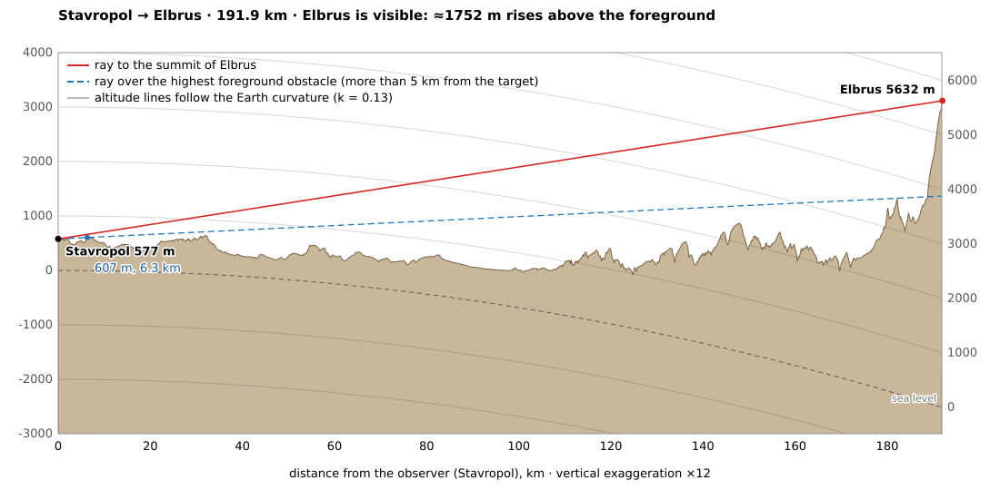

# geo-points-view

Can you see a distant summit from where you stand? `geo-points-view` takes two points,
an observer **A** and a target **B**, and checks the line of sight between them. It builds
a terrain profile along the great circle from the
[Copernicus DEM](https://dataspace.copernicus.eu/explore-data/data-collections/copernicus-contributing-missions/collections-description/COP-DEM)
and accounts for Earth curvature and atmospheric refraction. It then reports whether the
summit is visible, which ridges come closest to hiding it, and how much of the mountain
rises above the foreground.



## Installation

Requires Python 3.9 or newer. There are no runtime dependencies: DEM tiles are downloaded
and decoded with the standard library alone. PNG rendering is optional and uses a locally
installed Google Chrome or Chromium; without one you still get the SVG.

```bash
git clone <repo-url> geo-points-view
cd geo-points-view
python3 -m venv .venv
source .venv/bin/activate
pip install -e .            # or: pip install -e ".[dev]" for tests and linting
```

On Debian/Ubuntu, `python3 -m venv` needs the `python3-venv` package
(`sudo apt install python3-venv`). Alternatively install the tool globally with
`pipx install .`.

Without installing anything, you can also run it straight from the checkout:

```bash
PYTHONPATH=src python3 -m geo_points_view --help
```

## Usage

```bash
geo-points-view A B [options]
```

`A` and `B` are `"lat,lon"` in decimal degrees (WGS84). Run it from the repository root:
by default results go to `./output/` and `./diagrams/`.

```bash
# Is Kazbek visible from Mtatsminda (Tbilisi)?
geo-points-view 41.6945,44.7860 42.6967,44.5183 --name-a Mtatsminda --name-b Kazbek

# Elbrus from the centre of Stavropol, ignoring buildings within 1 km of the observer
geo-points-view 45.0448,41.9691 43.3531,42.4369 --name-a Stavropol --name-b Elbrus --near-skip 1000

# Russian diagram and summary, official summit height, observer on a 40 m tower
geo-points-view 41.6945,44.7860 42.6967,44.5183 --name-a Мтацминда --name-b Казбек \
    --lang ru --h-b 5054 --eye 40

# South and west are negative; points and options can come in any order
geo-points-view -33.9628,18.4098 -34.3568,18.4740 --name-a "Table Mountain" --name-b "Cape Point"
```

The first run for a new area downloads the DEM tiles it needs (1×1° each, about 40 MB for
30 m tiles); later runs use the cache.

### Arguments

**Points**

| Argument | Default | Meaning |
|---|---|---|
| `A` | — | Observer, `"lat,lon"`. |
| `B` | — | Target, `"lat,lon"`. Approximate summit coordinates are fine, see `--snap-b`. |
| `--name-a NAME` | `A` | Observer name, used in the diagram and in file names. |
| `--name-b NAME` | `B` | Target name, used in the diagram and in file names. |
| `--eye M` | `2` | Eye height above the ground, m. Use it for towers and rooftops. |
| `--h-a M` | DEM | Observer ground altitude, m, instead of the DEM value. |
| `--h-b M` | DEM | Target altitude, m, e.g. the official summit height instead of the DEM pixel. |
| `--snap-a M` | `0` (off) | Move A to the highest DEM pixel within this radius, m, e.g. "the highest point of the city". |
| `--snap-b M` | `1000` | Move B to the highest DEM pixel within this radius, m. `0` uses B exactly as given. |

**Model**

| Argument | Default | Meaning |
|---|---|---|
| `--k K` | `0.13` | Refraction coefficient used for the diagram and the obstacle list. The summary always also shows `k = 0` (no refraction) and `k = 0.20` (strong). |
| `--step M` | `15` | Profile sampling step, m. Half a 30 m DEM pixel. |
| `--near-skip M` | `300` | Ignore terrain this close to the observer, m. The DEM is a surface model, so nearby buildings and trees would otherwise block the view. Raise it when standing in a city centre. |
| `--summit-zone M` | `300` | Ignore the target's own summit cone within this distance of B, m. |
| `--massif-zone M` | `5000` | The "foreground" ends this far before B, m. The slopes of the target's own massif are not counted as foreground. |

**Output**

| Argument | Default | Meaning |
|---|---|---|
| `--lang {en,ru}` | `en` | Language of the diagram and of the console summary. |
| `--output-dir DIR` | `output` | Each run writes to `DIR/<a>-<b>-<timestamp>/`. |
| `--diagrams-dir DIR` | `diagrams` | The SVG is also copied to `DIR/<a>-<b>.svg`. |
| `--no-diagram` | — | Don't copy the SVG to the diagrams directory, e.g. for experiments. |
| `--no-png` | — | Don't render the PNG. |
| `--browser PATH` | search `PATH` | Chrome/Chromium executable used for the PNG. |
| `--cache-dir DIR` | `~/.cache/geo-points-view/dem` | Where DEM tiles are cached. Respects `XDG_CACHE_HOME`. |
| `-q`, `--quiet` | — | Print only the summary, no download progress. |
| `--version` | — | Print the version and exit. |

### Outputs

Every run creates a new folder, `output/<a>-<b>-<YYYYMMDD-HHMMSS>/`. Names are lower-cased
and transliterated to ASCII, so `Казбек` becomes `kazbek`. The folder contains:

| File | Content |
|---|---|
| `profile.svg` | The diagram. |
| `profile.png` | The same diagram at 2× resolution (2200×1080), when Chrome/Chromium is available. |
| `result.json` | Points, distance, bearing, DEM tiles used, every refraction/sampling case, the top obstacles and the run parameters. |
| `profile.csv` | The terrain profile: distance, coordinates, interpolated height and pessimistic (max of 4 pixels) height for every sample. |

The SVG is also copied to `diagrams/<a>-<b>.svg`, overwriting the previous diagram for the
same pair. `output/` is git-ignored. `diagrams/` is committed and marked `binary` in
`.gitattributes`, so git stores each diagram as a whole image and shows no text diffs for it.

### Reading the summary

The summary has one row per refraction coefficient `k` and DEM sampling mode. `bilinear`
interpolates between pixels. `max4` takes the highest of the four surrounding pixels, which
gives a pessimistic estimate.

| Column | Meaning |
|---|---|
| visible | Whether the ray to the summit clears every point on the route (outside the near and summit zones). |
| angle | Elevation angle of the summit as seen by the observer. |
| highest point on the route | The point with the largest elevation angle. Often it is the target's own shoulder just below the summit. |
| visible top | How much of the target is above that point. |
| above foreground | How much of the target rises above the highest point outside `--massif-zone`. In practice this is "how much of the mountain you see above the ridges in front of it". |

The obstacle list shows the highest-angle points (at least 2 km apart) and their
*clearance*: how far each one sits below the ray to the summit. A negative clearance means
that point blocks the summit.

In the diagram, the observer's horizontal is flat and light rays are straight lines. The
grey altitude lines curve down with the Earth, so each altitude has a label on both the
left and the right edge. The dashed dark line is sea level.

## How it works

1. **Terrain.** Copernicus GLO-30 (30 m) tiles are read from the public AWS bucket. Where
   a 30 m tile is not published (e.g. parts of the South Caucasus) the GLO-90 (90 m) tile
   is used instead, and a missing tile is treated as sea.
2. **Profile.** Heights are sampled every `--step` metres along the great circle from A to
   B.
3. **Geometry.** Every sample is placed in the observer's tangent-plane frame on a sphere
   with the effective radius `R / (1 − k)`. Refraction bends light rays, and this radius
   makes them straight. The summit is visible if its elevation angle exceeds every
   obstacle's.
4. **Visible part.** The ray over the worst obstacle is extended to the target's distance.
   The target's altitude minus the ray's altitude there is the part you can see.

## Limitations

- The Copernicus DEM is a *surface* model: it includes forest canopy and buildings. Peaks
  and ridges are therefore slightly higher than bare ground, which makes the answer
  conservative. Near the observer, use `--near-skip`, `--eye` or `--h-a`.
- Geometric visibility is not the same as seeing the mountain: beyond ~100 km, haze
  usually hides it except on very clear days.
- Refraction varies with weather. Compare the `k = 0` and `k = 0.20` rows to see how much
  it matters.
- The DEM's summit pixel is usually a few metres to a few tens of metres below the official
  height. Use `--h-b` for the official value.

## Development

```bash
pip install -e ".[dev]"
pytest            # tests use synthetic DEM tiles, no network access
ruff check .
```

The tests are plain `unittest`, so `PYTHONPATH=src python3 -m unittest` works without
pytest too.

## License

The code is released under the [MIT License](LICENSE). The elevation data it downloads has
its own terms, see below.

## Data attribution

Copernicus DEM © DLR e.V. 2010–2014 and © Airbus Defence and Space GmbH 2014–2018,
provided under COPERNICUS by the European Union and ESA; all rights reserved.
